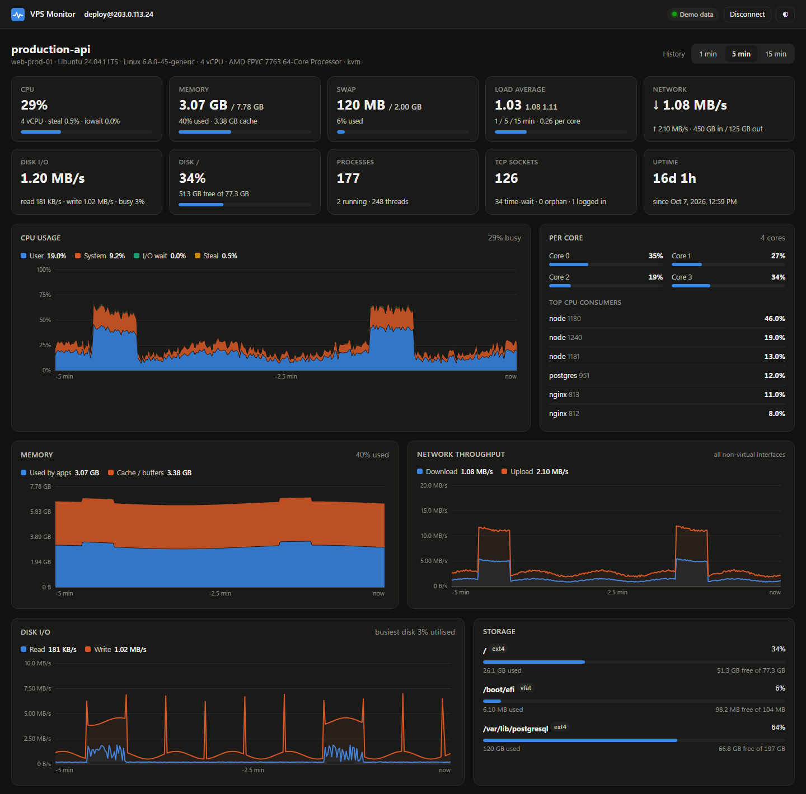
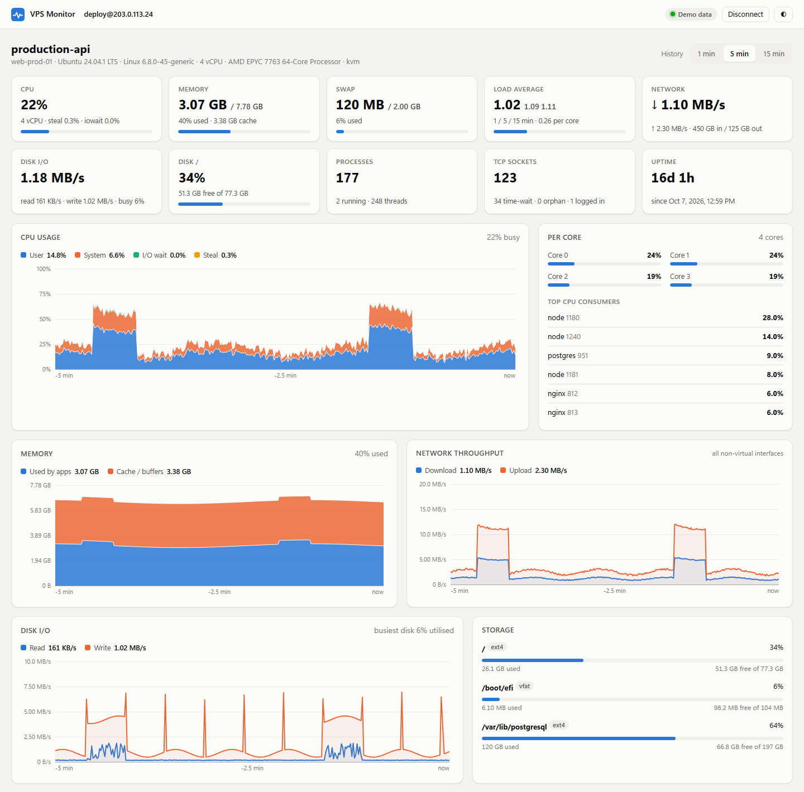
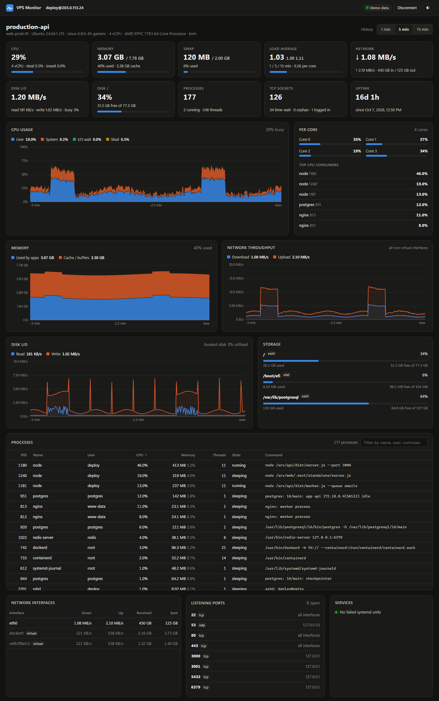

<div align="center">


# VPS Monitor

**A tiny Windows app for real-time monitoring of your Linux VPS over SSH.**
You get CPU, memory, network, disk, processes and open ports on one live dashboard, with nothing to install on the server.

[](https://github.com/Chamesss/VPS-system-monitor/releases/latest/download/VPSMonitor.exe)
[](https://github.com/Chamesss/VPS-system-monitor/actions/workflows/build.yml)

[](LICENSE)

**[⬇ Download VPSMonitor.exe](https://github.com/Chamesss/VPS-system-monitor/releases/latest/download/VPSMonitor.exe)** · ~120 KB · no installer



</div>

## Why

You have a VPS (DigitalOcean, Hetzner, AWS Lightsail, OVH, Linode, Vultr, a homelab box...) and
want to see what it's doing **right now** without setting up Grafana, Netdata, Zabbix or an
agent. You also don't want to squint at `htop` in a terminal.

VPS Monitor is one small `.exe`. Run it, enter your SSH login, and watch the server live.

## Features

- **Agentless.** Nothing is installed on the server. A read-only shell script reads `/proc` once a
  second over your normal SSH connection, then stops when you disconnect.
- **CPU:** total and per core, split into user / system / I/O wait / **steal** (handy on oversold
  VPS hosts). Load average and the top CPU consumers.
- **Memory & swap:** memory used by apps vs. cache and buffers.
- **Network:** download and upload throughput, per interface with totals. Docker and other virtual
  interfaces are excluded from the totals so traffic isn't counted twice.
- **Disk:** read and write throughput, utilization, and space used per mount, with "almost full"
  warnings.
- **Processes:** sortable and searchable table with CPU %, memory, threads, state, user and full
  command line.
- **Server health:** listening ports, failed systemd units, TCP sockets, logged-in users, uptime.
- **History:** live charts covering 1, 5 or 15 minutes. Hover a chart to see the exact values at
  any moment.
- **Saved servers.** A server is remembered after the first successful login, so next time it's one
  click. Passwords can be saved, encrypted with your Windows account (DPAPI).
- **Password, private key, or SSH agent / `~/.ssh/config`** login.
- **Auto-reconnect** when the connection drops.
- **Setup check.** On first launch the app checks for the OpenSSH client and shows how to install it
  if it's missing.
- **Light and dark themes**, following Windows or set manually.
- **Demo mode.** Try the whole dashboard with simulated data and no server.

<details>
<summary><b>More screenshots</b></summary>

Light theme:



The full dashboard, including processes, interfaces, ports and services:



<sub>Screenshots use the built-in demo mode, so the data is simulated.</sub>
</details>

## Quick start

1. **[Download `VPSMonitor.exe`](https://github.com/Chamesss/VPS-system-monitor/releases/latest/download/VPSMonitor.exe)**
   and run it. No install needed; put it on your Desktop or anywhere else.
   - Windows SmartScreen may say *"Windows protected your PC"* because the exe isn't code-signed.
     Click **More info → Run anyway**, or [build it yourself](#build-from-source).
2. Enter your server's **host / IP**, **port**, **username**, and choose **Password**, **Private
   key** or **Agent / config**.
3. Click **Connect**. The dashboard appears within a couple of seconds, and the server is saved for
   next time.

Closing the window ends the session.

## Requirements

| | |
|---|---|
| **Your PC** | Windows 10 (1903 or newer) or Windows 11. It uses the built-in .NET Framework 4.8, so there's no runtime to install. |
| **SSH client** | The **OpenSSH Client** that ships with Windows. If it's missing, the app tells you how to install it. Password and passphrase logins need OpenSSH 8.4+ (Windows 11 has it; on older Windows 10 run `winget install Microsoft.OpenSSH.Preview`). |
| **Window** | Microsoft Edge (preinstalled) or Google Chrome is used as the app window. Without either, the dashboard opens in your default browser. |
| **Server** | Any Linux server with `/proc`, `sh` and `base64`: Ubuntu, Debian, CentOS / Rocky / Alma, Fedora, Arch, Alpine and so on. Root isn't required. |

## Security & privacy

- **It talks only to your server, over SSH.** There's no telemetry, no account and no cloud.
- **The server script is read-only.** It only reads `/proc`, `df`, `ps`, `ss`, `who` and
  `systemctl list-units`. You can read the whole script in [`src/remote.sh`](src/remote.sh).
- **Passwords are never put on a command line.** `ssh.exe` asks for them through `SSH_ASKPASS`, and
  VPS Monitor answers.
- **Saved passwords and passphrases** are encrypted with Windows DPAPI, so only your Windows
  account on that PC can decrypt them. They're saved only if you tick *Remember*.
- **Host keys:** a new server is trusted on first connect. If a known server's key changes later,
  the app refuses to connect.
- **The local UI is protected.** It's served on `localhost` only, behind a random per-launch token,
  so other websites or local programs can't drive it.
- **Where your data lives:** everything is outside the app, so the exe itself is safe to share.

  | What | Location |
  |---|---|
  | Saved servers (+ encrypted secrets) | `%APPDATA%\VPSMonitor\sessions.json` |
  | Host keys | `%APPDATA%\VPSMonitor\known_hosts` (plus your `~/.ssh/known_hosts`) |
  | Window profile | `%LOCALAPPDATA%\VPSMonitor\WebView` |

  To remove everything, delete those two folders.

## How it works

```
VPSMonitor.exe ──starts──> local server on localhost (random port + token)
      │                         ▲   live updates (server-sent events)
      │                         │
      ├──opens──> Edge/Chrome app window (the dashboard: src/ui.html)
      │
      └──runs───> ssh.exe user@server "read-only script"  ──>  /proc snapshot every second
```

The exe is a small C# program (.NET Framework 4.8). It starts the system `ssh.exe`, which sends a
plain-text snapshot of `/proc` every second. The dashboard turns the differences between
snapshots into rates and percentages. The ssh processes sit in a Windows job object, so they always
stop with the app.

## Build from source

You need the [.NET SDK](https://dotnet.microsoft.com/download) (any recent version) on the build
machine only.

```powershell
git clone https://github.com/Chamesss/VPS-system-monitor.git
cd VPS-system-monitor
.\build.ps1            # -> dist\VPSMonitor.exe + dist\VPSMonitor.exe.sha256
```

| Path | What |
|---|---|
| `src/ui.html` | The whole interface: HTML, CSS and JS in one file, embedded in the exe |
| `src/remote.sh` | The read-only script that runs on the server |
| `src/SshMonitor.cs` | Starts ssh, streams snapshots, reconnects |
| `src/WebServer.cs` | The local, token-protected API and live-event stream |
| `src/Tools.cs` | Checks for the required tools on startup |
| `src/Store.cs` | Saved sessions + DPAPI encryption |

**Try the UI without building:** open `src/ui.html?demo` in a browser.
**Preview the "missing tools" screen:** run the exe with the environment variable
`VPSMON_FAKE_NO_SSH=1`.

## Releasing

Releases are built by GitHub Actions. From a clean `main` branch:

```powershell
.\release.ps1 1.1.0          # bump version, tag v1.1.0, push -> CI builds and publishes the release
.\release.ps1 1.1.0 -Local   # or build here and upload with the GitHub CLI right away
```

Every push and pull request is also built by CI, and the exe is available as a workflow artifact.

## Contributing

Issues and pull requests are welcome, from bug reports to new metrics (Docker containers, GPU,
temperatures...) or support for more platforms. Please keep the app small and dependency-free.

## License

[MIT](LICENSE) © chams
